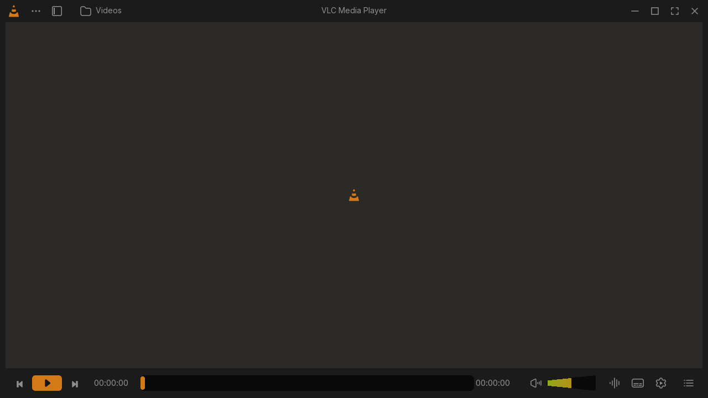

# VLC Redesign — Skins2 Theme

A working VLC skin based on [VLC Redesign by Juxtopposed](https://www.figma.com/community/file/1691465999134370980/vlc-redesign). It uses VLC's native Skins2 interface, original exported icons, the Inter font, a real video surface and a real playlist.

**[Download VLC-Redesign.vlt](https://github.com/s1rd0/VLC-Redesign/releases/latest/download/VLC-Redesign.vlt)** · [Releases](https://github.com/s1rd0/VLC-Redesign/releases) · [Bundled build](dist/VLC-Redesign.vlt)



The image above is an offline rendering of the theme XML, not a screenshot of VLC playback.

## Requirements

- VLC 3.x with Skins2 support on Windows or Linux. Native playback was tested on **VLC 3.0.24 for Windows**; Linux runtime testing has not been performed.
- VLC for macOS does not support Skins2.
- Python is only needed to rebuild the theme, not to install the `.vlt` file.

## Install

1. Download `VLC-Redesign.vlt` from [the latest release](https://github.com/s1rd0/VLC-Redesign/releases/latest).
2. Open VLC's **Tools → Preferences → Interface**.
3. Select **Use custom skin** and choose the downloaded `.vlt` file.
4. Save and restart VLC.

To return to the standard VLC interface, select **Use native style** in the same preferences. See [VideoLAN's skin installation guide](https://docs.videolan.me/vlc-user/desktop/3.0/en/addons/skins.html).

## Windows launchers

When using the complete repository, you can drag a media file onto a launcher:

- **`Launch-Skin.bat`** uses this skin, accurate seeking, DirectSound audio and 300 ms local-file caching.
- **`Launch-Fast-Seek.bat`** enables VLC's approximate fast seeking. It can resume several seconds **before** the position you selected, depending on the media's keyframes.
- **`Preview-Skin.bat`** uses VLC's standard audio-output selection and caching settings.

Each launcher opens a separate VLC instance and stores its state under `build/`. It does not change the main VLC preferences. Selecting the `.vlt` file directly does not enable launcher options. VLC must be installed in its standard Windows location for these scripts; otherwise, use VLC preferences or adjust `VLC_EXE` in the script.

## Controls

- Play/pause, stop, previous/next, seek, elapsed time, duration and volume.
- An actual VLC playlist, with double-click playback, scrolling, add/remove, load/save, shuffle and repeat.
- A button that switches between the player and playlist layouts.
- Native VLC menus for audio tracks, subtitles, media information and preferences.
- File, folder, disc and network-stream opening actions.
- A movable and resizable window, title-bar maximize/restore and a fullscreen control bar.

The default window is **1280×720**, with a **1000×600** minimum. Volume uses Skins2's native **0–200%** range: **100% is halfway along the slider**. Hover over it to read the current percentage.

## What a `.vlt` can support

This is an adaptation for VLC's existing skin engine. The concept's thumbnail library is represented by VLC's playlist. Preference dialogs and advanced media-opening dialogs retain VLC's native appearance.

Skins2 does not expose live seek thumbnails, animated movement of a functional sidebar, or interpolation of the progress handle between engine updates. The progress-fill sprite has **257 states** instead of 101, reducing its largest step at the default size from 7 to 3 pixels. This improves display resolution; it does not provide continuous animation.

## Seeking and audio response

Playback response depends on VLC, codecs, keyframe spacing and audio output. On a local 4K/60 VP9 sample, native D3D11VA was active. Three accurate-seek tests reached VLC's `Decoder wait done` checkpoint after roughly **0.84–1.22 seconds**. Reducing caching to 300 ms and choosing DirectSound did not show a clear improvement in those trials.

Fast seeking reached the same decoder checkpoint after **14–28 ms**, but its effective destinations were **3.5–5.4 seconds earlier** than requested. These are decoder-pipeline measurements, not monitor-response times or performance guarantees.

DirectSound is provided as an alternative for delayed volume response. Immediate audible changes have not been confirmed. Above 100%, VLC applies software amplification to new audio samples; samples already queued retain their previous gain.

## Build from source

Use Python 3.10+ and run these commands from the repository root:

```sh
python -m pip install -r requirements.txt
python tools/build_assets.py
python tools/build_theme.py
python tools/validate_skin.py skin --strict
python tools/package_skin.py skin dist/VLC-Redesign.vlt --strict
```

Original exports are included in `design-assets/exported/`, so rebuilding does not require a Figma account or network access. Keep the bundled static Inter font and font license in `skin/assets/`; the asset generator does not regenerate that font.

The packager validates the XML and referenced assets, includes the attribution/font notices, and writes a deterministic gzip-compressed USTAR archive. `dist/SHA256SUMS` records the checksum of the released build.

Additional checks:

```sh
python tools/render_preview.py
python tools/check_native_slider_bindings.py
```

The preview renderer checks layout assets without launching VLC. The native binding regression requires a Windows VLC 3.x installation; it checks separate `time` and `volume` bindings in all three layouts using the installed XML reader and relevant parser state transitions. It also reproduces the old failure by restoring a self-closing `Playtree`. Generated reports remain in the ignored `build/` directory.

`tools/create_test_media.py` and `tools/measure_presented_frame_latency.py` provide optional synthetic-media diagnostics. Their memory-video callback test does not measure physical display latency or audible volume response.

## Validation

The packaged theme passes Skins2 DTD 2.0 validation and asset/action checks. Native Windows playback tests confirmed skin loading, video/audio decoding, playback control, seeking and volume commands without Skins2 warnings. The fast-seek launcher was also tested with the `.vlt` and a local 4K VP9 file.

Automated clicks, window resizing and layout switching have not been verified through the desktop automation tool because it did not expose the Skins2 window. See [format and test references](docs/SKINS2-SOURCES.md) and [release notes](RELEASE_NOTES.md).

## Credits and licenses

- **Visual design:** Juxtopposed, [VLC Redesign](https://www.figma.com/community/file/1691465999134370980/vlc-redesign), credited under **CC BY 4.0**. The theme adapts the layout and exports into VLC bitmap controls. See [design attribution](design-assets/ATTRIBUTION.md).
- **Inter:** SIL Open Font License 1.1; [full license](design-assets/OFL-Inter.txt) is also included in the `.vlt`.
- **Skins2 DTD:** from VideoLAN VLC 3.0.24; [upstream source](https://github.com/videolan/vlc/blob/3.0.24/share/skins2/skin.dtd) and the bundled [GPL text](docs/COPYING-VLC.txt).

This project is an unofficial adaptation and is not affiliated with VideoLAN or Juxtopposed. Component notices retain their respective licenses; this release does not assign a new blanket license to the build scripts.
